<p align="center">
  
</p>

<p align="center">
  <a href="https://www.linkedin.com/in/ankurvats/"></a>
  <a href="https://www.youtube.com/@the_ImmerSecGuy"></a>
  <a href="mailto:ankurvats.sec@gmail.com"></a>
  
</p>

---

### 👋 Hi, I'm Ankur

I'm an **Offensive Security Engineer** with **10+ years in security**, split between **in-house FinTech / financial services**, where a single missed finding can mean real money and regulatory pain, and **security consulting**, where I've run engagements for clients across many industries.

I break things on purpose so attackers can't do it for real: web apps and APIs, Active Directory, internal networks and cloud. Then I help teams fix the root cause, not just the symptom. Consulting taught me to scope fast, work inside tight rules of engagement and write reports that executives and engineers can both act on. My **CISA** and **CISM** background means I can speak to both the engineer fixing the bug and the auditor asking about the control.

```yaml
focus:        [penetration testing, red teaming, application security]
experience:   [FinTech / financial services, security consulting]
currently:    sharpening OSCP-style tradecraft and studying AI / LLM security
side_quests:  designing CTF challenges (2020 – 2025)
ask_me_about: AD attack paths, API security, bridging pentest findings to GRC
```

---

### 🎯 What I do

| Area | What that looks like |
|---|---|
| 🕸️ **Web & API security** | OWASP Top 10 / API Top 10, auth and business-logic flaws, payment-flow abuse |
| 🏰 **Active Directory** | Enumeration, Kerberos attacks, ACL abuse, lateral movement, domain-dominance paths |
| 🌐 **Network & infrastructure** | Internal / external pentests, service exploitation, privilege escalation (Windows & Linux) |
| ☁️ **Cloud & containers** | Azure and AWS misconfigurations, IAM attack paths, Docker / Kubernetes reviews |
| 💼 **Security consulting** | Scoping and leading client engagements, clear reporting, remediation guidance and retesting |
| 🧩 **Security governance** | Turning technical findings into risk language for audit, compliance and leadership |
| 🤖 **AI security (learning)** | Prompt injection, LLM application threats, ML fundamentals |

---

### 🚩 CTF challenges I've designed

Since 2020 I've written original challenges for live Capture The Flag events, each built around one real-world weakness and shipped as a Flask app, C binary or Docker lab.

| Year | Challenges | Categories |
|:-:|---|---|
| **2025** 🆕 | **The Perrin–Woods Confection** (300 pts): a "recipe" puzzle where number sequences, modular arithmetic and layered encoding hide the flag | Cryptography |
| **2024** | analyze_me · crack_me · inspect_me · fun_with_me | Cryptanalysis service, reverse engineering, exfiltration forensics, esoteric code |
| **2023** | Linux buffer overflow · reverse engineering · network analyser · compression · CORS | Binary exploitation, RE, forensics, web |
| **2022** | portal-manager · container-security · SOP · packet analysis | Path traversal, command injection, same-origin policy, forensics |
| **2021** | CVE-2021-41773 · Solr injection · secret_agent · Greetings · fruit_basket | Real-CVE labs, web logic |
| **2020** | Solr injection (first edition) | Weak credentials, exposed Apache Solr |

---

### 🧰 Toolbox

<p>
  
  
  
  
  
  
  
</p>
<p>
  
  
  
  
  
  
  
  
</p>

---

### 🏅 Certifications

<p>
  
  
  
  
</p>

| Area | Certification | Issuer |
|---|---|---|
| 🛡️ **Governance & audit** | **CISM**: Certified Information Security Manager | ISACA |
| | **CISA**: Certified Information Systems Auditor | ISACA |
| ⚔️ **Offensive security** | **CRTP**: Certified Red Team Professional | Pentester Academy |
| | **ECSA**: Certified Security Analyst (Penetration Testing) | EC-Council |
| | **CEH**: Certified Ethical Hacker | EC-Council |
| | **OSCP**: OffSec Certified Professional *(in progress)* | OffSec |
| ☁️ **Cloud** | **Microsoft Certified: Azure Fundamentals** | Microsoft |
| | **OCI Foundations Associate** | Oracle |
| 🔎 **Defense & monitoring** | **CNSS**: Certified Network Security Specialist | ICSI |
| | **IBM QRadar SIEM Foundation** | IBM |

---

### 🔭 Currently

- 📚 Building a structured offensive-security knowledge base: methodology, checklists and lab write-ups for every phase from recon to domain admin
- 🧠 Studying **machine learning, deep learning, NLP and reinforcement learning** to get serious about **AI / LLM security**
- 🎥 Breaking down security concepts in plain language on my YouTube channel, **[The ImmerSec Guy](https://www.youtube.com/@the_ImmerSecGuy)**
- 🛠️ Writing small automation tools in PowerShell and Python to make my own workflow faster

---

### 🤝 Let's connect

Open to conversations about **offensive security, security consulting, AppSec in financial services, and AI security**.
The fastest way to reach me is [LinkedIn](https://www.linkedin.com/in/ankurvats/) or [email](mailto:ankurvats.sec@gmail.com).

<p align="center">
  <sub>⚖️ Everything I publish here is for education and authorised testing only.</sub>
</p>
